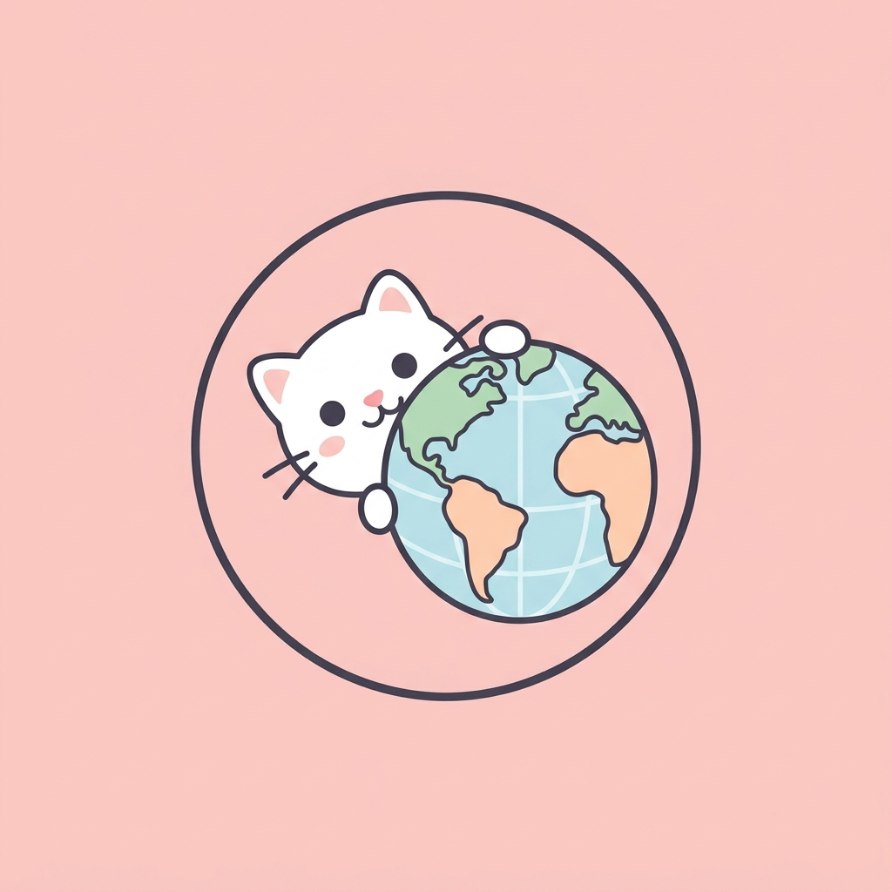

# 🌸 Pinkie for Chrome 🌸

*"For cute girls and gentle boys ~ ♡"*

Made with lots of love 💖 by **JustDuyen**.

---

Welcome to **Pinkie for Chrome**! This is the official Google Chrome browser theme from the Pinkie ecosystem. It transforms your browser into a clean, flat, and super adorable pastel workspace! 🎀

## 📸 Sneak Peek

## ✨ Super Cute Features ✨

- 🌸 **Flat Minimalist UI**: The entire browser frame and tabs are flattened using a unified pastel pink palette. No distracting borders, just pure sweetness! ☁️
- 🐈 **Cat on New Tab**: A cute white cat will peek out from the bottom right corner of every new tab page you open to say hello to you!
- 🎨 **Kawaii Buttons**: All the browser toolbar buttons (back, forward, refresh) now have a sweet pink background to make them extra cute!
- 🎀 **Unified Branding**: Syncs perfectly with `Pinkie for Vscode` and `Pinkie for Obsidian`.

## 🎀 How to Install (Developer Mode)

1. Open Google Chrome and go to `chrome://extensions/`
2. Turn on **Developer mode** (the toggle switch in the top right corner).
3. Click the **Load unpacked** button.
4. Select the `Pinkie-for-Chrome` folder.
5. Yay! Enjoy your super cute new browser! 🎉

*Enjoy browsing with love & cuteness!* ✨ (´ ω `♡)
